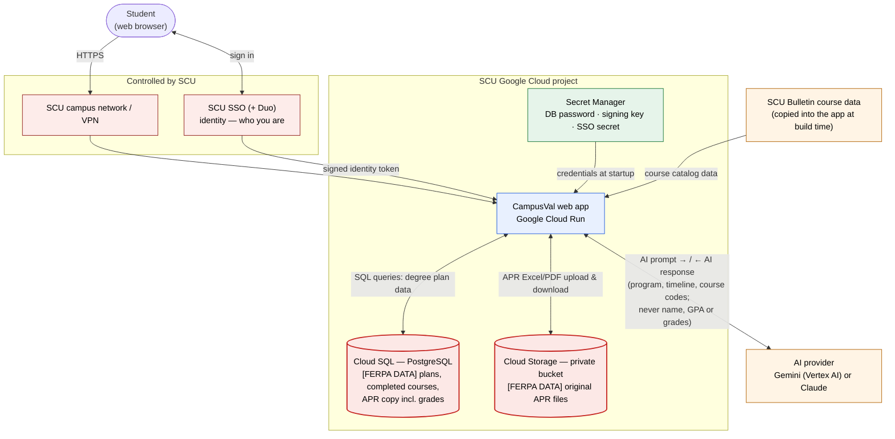
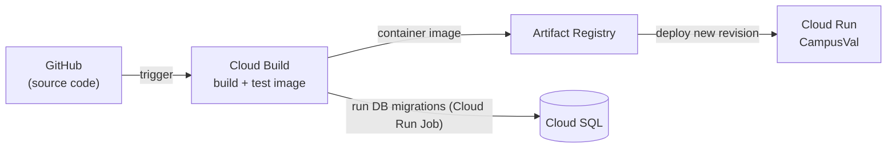

# CampusVal Architecture

## What CampusVal Does

CampusVal is a web application that helps Santa Clara University undergraduates plan their degree: it shows SCU Core and major requirements from the SCU Bulletin, lets students build four-year and quarter-by-quarter plans, view the Academic Progress Report (APR) they export from Workday, and ask an AI advisor planning questions. It is a planning aid — Workday and SCU advisors remain the official record.

## Simple Diagram (target, on SCU Google Cloud)



### How code reaches production



### Where secrets live

```
Secret Manager
   |
   +--> Database credentials        (campusval-database-url)
   +--> Upload signing key          (campusval-storage-signing-secret)
   +--> AI credentials              (none with Vertex AI — uses the service account;
   |                                 campusval-gemini-api-key / -anthropic-api-key otherwise)
   +--> SSO credentials             (campusval-oidc-client-secret, when SCU SSO is live;
                                     Clerk keys until then)
```

**Who controls what:** red = SCU (network, SSO); blue/green = SCU's Google Cloud project (application, database, storage, secrets — administered by SCU IT); orange = external services (AI provider) or data copied from SCU's public website.

**Today (before migration):** the same app runs on Vercel, with Neon PostgreSQL, Vercel Blob for APR files and Clerk for sign-in — see [CURRENT_VS_TARGET.md](CURRENT_VS_TARGET.md).

## What Happens When a Student Logs In
1. The student opens CampusVal from the SCU network or VPN.
2. CampusVal sends them to SCU's sign-in page (with Duo if SCU requires it). *Today: Clerk's sign-in form.*
3. SCU confirms who they are and returns them to CampusVal with a signed identity token.
4. CampusVal checks the account is an SCU account (or an invited reviewer) and starts a session (a secure cookie).
5. Every later request carries the session; the server only ever shows that student's own records.

## What Happens When an APR Is Uploaded
1. The student exports their APR from Workday (Excel or PDF) and selects it in CampusVal.
2. CampusVal gives the browser a one-time, 15-minute upload permission for exactly one file.
3. The file goes into the private storage bucket under a random name tied to the student.
4. The server checks it (right file type, size limit, really a spreadsheet/PDF, not another student's report) in memory.
5. A structured copy of the report's table is saved in the database; the original file stays in the private bucket.
6. The student sees the report in the sidebar (grades hidden there) and can open the full report or delete it at any time. Nobody else — not advisors, not admins — can open it in the app.

Details: [APR_STORAGE_AUDIT.md](../security/APR_STORAGE_AUDIT.md).

## What Happens When AI Is Used
1. The student types (or speaks) a question in the AI advisor.
2. CampusVal saves the question in the student's conversation history.
3. CampusVal builds a prompt: SCU policy rules, Bulletin offering data for the student's remaining courses, and a short profile (program, timeline, completed course codes). **It never includes the student's name, ID, GPA, grades or APR.**
4. The prompt goes to the SCU-approved AI provider (Gemini on Vertex AI recommended, or Claude).
5. The answer streams back to the student and is saved in their history. Nothing is logged.

Details: [AI_PROVIDER_MIGRATION.md](../migration/AI_PROVIDER_MIGRATION.md).

## Where Data Is Stored

| Information | Location |
|---|---|
| Who the student is (sign-in) | SCU SSO (target) · Clerk (today) |
| Profile, plans, schedules, completed courses, AI conversations | Cloud SQL PostgreSQL (target) · Neon PostgreSQL (today) |
| APR structured copy (includes grades) | Cloud SQL — `progress_reports.workbook` |
| Original APR and checksheet files | Private Cloud Storage bucket (target) · Vercel Blob (today) |
| Course catalog, requirements, schedules | Inside the application (copied from SCU's public Bulletin/Registrar) |
| Passwords and keys | Secret Manager (target) · Vercel environment variables (today) |
| Logs | Cloud Logging — request method, path, status, event names; no student content |

## Sensitive Data
CampusVal holds FERPA-protected education records: completed courses, grades (inside uploaded APRs), GPA and student ID (if the student enters them), degree and quarter plans. Every one is visible only to the student it belongs to (a student may choose to share a plan — never an APR — with an advisor). The only data that leaves SCU's cloud project is the minimized AI prompt. Full list: [FERPA_DATA_INVENTORY.md](../security/FERPA_DATA_INVENTORY.md).

## External Services

| Service | What it is used for | Data sent | Status |
|---|---|---|---|
| SCU SSO (IdP) | Sign-in | Sign-in redirect; receives identity token | Target (needs SCU registration) |
| Clerk | Sign-in (temporary) | Email, session | Current; removed after SSO |
| Gemini (Vertex AI / Gemini API) or Anthropic Claude | AI advisor answers, voice transcription/speech (Gemini) | Minimized prompt, conversation, voice clip | Off until SCU sets `AI_PROVIDER` |
| SCU Bulletin / Registrar websites | Source of catalog/schedule data | Nothing — data copied offline | Not contacted at runtime |
| Workday availability endpoint | Live seat counts | Course/term query | Disabled; needs SCU approval |
| ElevenLabs | Optional alternative voice | Answer text | Unused (no key configured) |

More: [CAMPUSVAL_DATA_FLOW.md](CAMPUSVAL_DATA_FLOW.md) · [TRUST_BOUNDARIES.md](../security/TRUST_BOUNDARIES.md) · [SCU_BULLETIN_DATA_FLOW.md](SCU_BULLETIN_DATA_FLOW.md).
