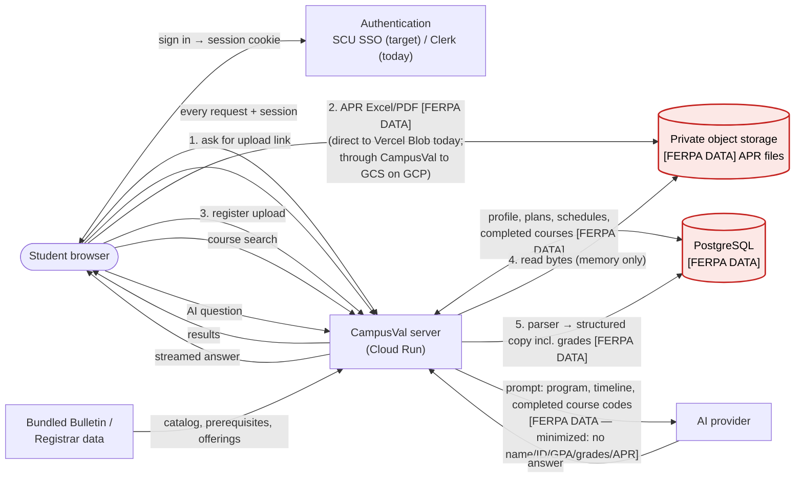

# CampusVal Data Flow

Data marked **[FERPA DATA]** is a student education record.

### APR path (step by step)
`Browser → POST /api/storage/uploads/request-url → (PUT bytes) private storage → POST /api/progress-reports → validation + parser (memory) → progress_reports.workbook (database) + original kept in storage`

### Course search path
`Browser → GET /api/courses | /api/course-search → bundled Bulletin data → Browser` (no student data, no AI)

### AI path
`Browser → POST /api/openai/conversations/:id/messages → minimized student context + Bulletin offering data + policy text → AI provider → streamed answer → Browser (and saved in messages)`

### What never leaves CampusVal's cloud project
APR files, APR contents, grades, GPA, student ID, name, saved schedules, checksheets.
