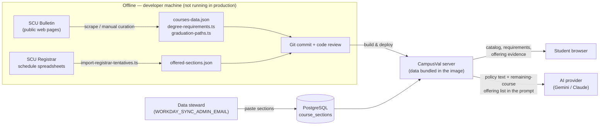

# SCU Bulletin & Course Data Flow (CampusVal)

> **Terms**
> - **SCU Undergraduate Bulletin** — SCU's official public catalog (`https://www.scu.edu/bulletin/undergraduate/`): course descriptions, prerequisites, program requirements.
> - **Registrar schedule** — the published / tentative list of course sections per quarter.
> - **Scraping** — a program reading public web pages to extract data.
> - **Bundled data** — data files committed to the repository and shipped inside the application, so the app never has to fetch them while running.

## The short answer

- CampusVal does **not** scrape the Bulletin while it runs. **No server code fetches any SCU web page at request time** (verified: the only outbound `fetch` calls in the server are to object storage, the configured AI provider, the optional ElevenLabs voice, and the optional SCU-approved Workday availability endpoint, which is **off**).
- Bulletin and Registrar data were extracted **offline**, reviewed, and **committed as data files**. They change only when a developer re-imports, commits, and redeploys.
- The original Bulletin scraper is **not in this repository** (the catalog file records "Scraped April 2026 from the public bulletin HTML"). Re-scraping is a manual developer task today.
- The AI advisor receives Bulletin-derived text **inside its prompt**; it never browses the web.

## Data sources

| Dataset | File (in `artifacts/api-server/src/data/`) | Source | How it got there | Last changed |
|---|---|---|---|---|
| Course catalog — 2,333 courses: code, title, units, description, prerequisite sentence, Core tags | `courses-data.json` (1.9 MB), loaded by `courses.ts` | Bulletin chapters 3–5 | Offline scrape (April 2026); 468 truncated descriptions restored from the 2026–27 Bulletin (Sept 2026) | 2026-09-27 |
| University Core & college requirements | `degree-requirements.ts` | Bulletin chapters 2, 4, 5, 8; school Core pages | Hand-curated; each group records `sourceUrl`, `academicYear`, `lastVerified` | see git log |
| Majors, minors, 4-year plans | `graduation-paths.ts` | Bulletin program pages; official school 4-year-plan PDFs | Hand-curated with provenance + `sequenceTrust` tier | see git log |
| Sections offered (4,063 rows) | `offered-sections.json`, `offered-sections.ts` | Registrar: Fall 2026 published schedule; Winter/Spring 2027 **tentative** spreadsheets | `scripts/import-registrar-tentatives.ts` (dry-run by default; `--apply` writes) | 2026-09-02 |
| Lecture/lab component markers | `registrar-component-markers.json` | Registrar schedule | `scripts/extract-registrar-component-markers.ts` | see git log |
| SCU policies (units, overload, probation…) | `policies.ts`, `advisor-prompt.ts` | Bulletin chapter 8 | Hand-written summaries | see git log |
| Live sections (optional) | PostgreSQL `course_sections` | Text pasted from Workday by the data steward | `POST /api/sections/sync` (only `WORKDAY_SYNC_ADMIN_EMAIL`) | runtime |
| Live seat availability (optional) | none — cached in memory | SCU-approved Workday endpoint | `lib/availability/providers/workday.ts` — **disabled** (`WORKDAY_AVAILABILITY_ENABLED=false`) | — |

Provenance rules are documented in [`docs/DATA_PROVENANCE.md`](../DATA_PROVENANCE.md).

## Flow

## Is it cached? Stored in PostgreSQL?
- Catalog, requirements and offered sections are **in memory**, loaded from the bundled files when the server starts. They are not in PostgreSQL.
- Only data-steward-pasted sections (`course_sections`) are in PostgreSQL.
- Live availability (when SCU enables it) is cached in memory per term for `WORKDAY_AVAILABILITY_CACHE_TTL_SECONDS` (default 60 s).

## Refresh schedule
**None automatic.** No cron job, scheduler or background task exists. A refresh is: run the importer (or re-curate), review the diff, commit, deploy. Recommendation for SCU: re-import once per Bulletin year (June) and when the Registrar publishes each quarter's schedule; long-term, an official SCU data feed would replace scraping.

## API routes that serve this data
`GET /api/courses`, `/api/courses/:code`, `/api/courses/:code/sections`, `/api/courses/:code/components`, `/api/course-search`, `/api/core-areas`, `/api/policies`, `/api/graduation-paths/*`, `/api/requirements*`, `/api/section-availability/status`, `/api/articulation` (transfer equivalencies). Catalog lookups are public reference data (no student data); requirement and plan routes that combine it with a student's record require sign-in.

## How AI uses it
`routes/openai.ts → buildOfferedScheduleBlock` lists the student's still-required major courses and the terms each is offered in `offered-sections.json` (marking 2027 Winter/Spring as tentative), and `data/advisor-prompt.ts` embeds SCU policy rules and resource links. This text is sent to the AI provider with each question. The model is instructed to cite policy and send students to official SCU sources for final decisions.

## Failure behavior
- Bundled data cannot "go down": if the Bulletin website is unavailable, CampusVal is unaffected (its copy may simply be out of date — every dataset shows its source and last-verified date to students).
- A course missing from the catalog is shown as unknown rather than invented.
- If the optional Workday availability endpoint fails or is stale, the seat status is shown as **unknown**, never guessed (`lib/availability/freshness.ts`).
- If the AI provider fails, the student gets a generic "temporarily unavailable" message.
