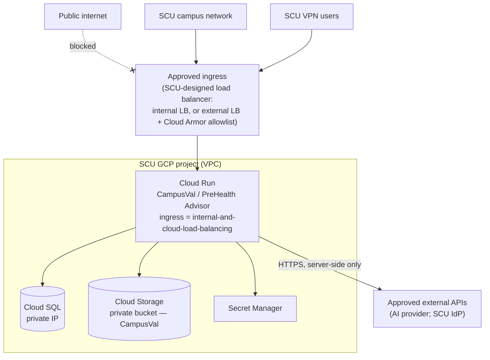

# Production Network Access — SCU Network / VPN Only

Covers **CampusVal** and **PreHealth Advisor**. Kept identical in both repositories.

> **Terms**
> - **Ingress** — which network traffic is allowed *into* a service.
> - **Load balancer** — the front door that receives browser traffic and forwards it to Cloud Run; it can terminate HTTPS, apply firewall rules and attach SCU's domain.
> - **Cloud Armor** — Google's web firewall for load balancers: allow/deny by source IP range, rate limiting.
> - **VPC** — SCU's private network inside Google Cloud.
> - **Serverless NEG** — the connector that lets a load balancer send traffic to a Cloud Run service.

**Important:** this repository cannot prove anything about SCU's network. The exact routing, VPN ranges, firewall rules, load balancer, DNS and organization policies must be designed and confirmed by SCU IT. Below is the intended shape and what the applications already do to fit it.

## Intended architecture



```
Internet
   X
   |
[Not directly exposed]

SCU Campus Network
        |
SCU VPN Users
        |
Approved ingress / load-balancing layer
        |
Cloud Run
        |
Private GCP services
```

## Two common ways SCU can implement "campus/VPN only"
1. **Internal Application Load Balancer** in SCU's VPC, reachable from campus/VPN via SCU's existing interconnect/VPN into GCP. Cloud Run ingress `internal` or `internal-and-cloud-load-balancing`. Nothing is on the public internet.
2. **External Application Load Balancer + Cloud Armor** policy allowing only SCU campus and VPN egress IP ranges (default deny), plus optional Cloud Armor rate limiting. Cloud Run ingress `internal-and-cloud-load-balancing` so the `*.run.app` URL cannot be used to bypass the load balancer.

Either way: SCU DNS name (e.g. a `scu.edu` hostname) on the load balancer with a managed TLS certificate; set `PUBLIC_APP_URL` to it and `TRUST_PROXY=1`.

## Application vs. infrastructure responsibilities

| Area | Application (done in code) | GCP / SCU infrastructure (SCU IT) |
|---|---|---|
| Listening | Binds `0.0.0.0:$PORT` (8080) in the container | — |
| Default ingress | `cloudbuild.yaml` deploys with `--ingress=internal-and-cloud-load-balancing` and `--no-allow-unauthenticated` (both overridable substitutions) | Decide final ingress + invoker setting once the LB path exists |
| Proxy awareness | `TRUST_PROXY` makes client IP/HTTPS detection correct behind the LB; HSTS sent only over HTTPS | Configure the LB, certificate, DNS |
| CORS / origin | Credentialed CORS only for `PUBLIC_APP_URL` (+ explicit `CORS_ALLOWED_ORIGINS`) | — |
| Who can sign in | CampusVal: `@scu.edu` + invited reviewers; both apps require sign-in for all user data | SSO restriction at SCU's IdP; network allowlist |
| Outbound traffic | Only to the configured AI provider (CampusVal), Clerk/SCU IdP, and Google APIs | Optional: VPC egress controls / firewall to restrict outbound destinations |
| Health checks | `/api/healthz` (liveness), CampusVal `/api/readyz` (DB check) | LB/Cloud Run probes |
| Rate limiting | Per-user caps (CampusVal: 12 APRs, size limits) | Cloud Armor rate-based rules |
| Org policy | — | e.g. `run.allowedIngress`, `sql.restrictPublicIp`, `storage.publicAccessPrevention`, `iam.disableServiceAccountKeyCreation` |

## Things to confirm with SCU IT
- Campus and VPN source ranges (or the interconnect design).
- Whether students off-campus are expected to use the VPN (this affects usability).
- Load balancer type, DNS names, certificate ownership.
- Whether `--no-allow-unauthenticated` (IAM-protected Cloud Run) stays on with IAP, or the LB/Cloud Armor layer is the only gate.
- Egress policy for the AI provider and identity provider endpoints.
