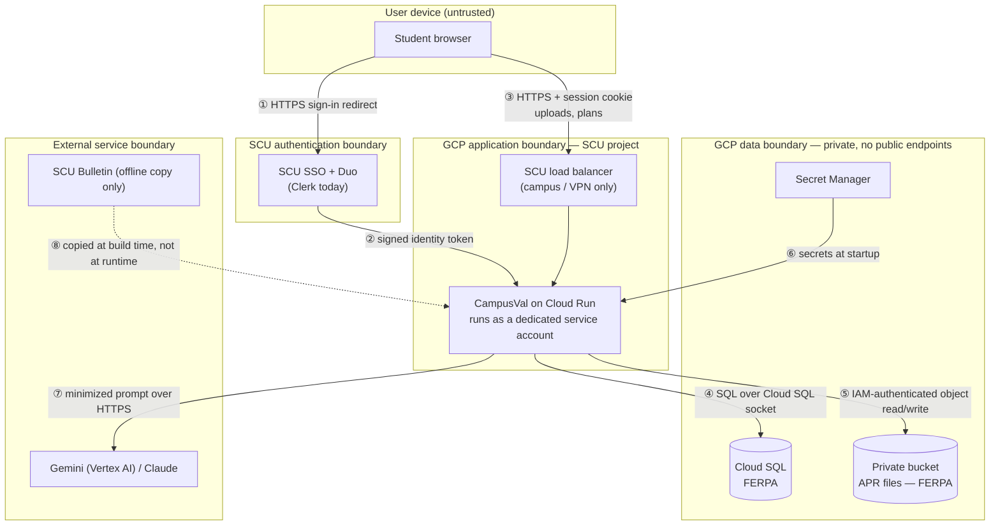

# Trust Boundaries — CampusVal

> **Trust boundary** — a line where data passes between parties that trust each other differently (e.g. a student's laptop and SCU's servers). Every crossing must be authenticated, authorized, or both.

| # | Crossing | What crosses | Authentication | Authorization | Sensitive data |
|---|---|---|---|---|---|
| ① | Browser → IdP | Sign-in | SCU SSO + Duo (Clerk today) | SCU decides who may sign in | Credentials go **only** to the IdP, never to CampusVal |
| ② | IdP → app | Identity token / session | Token signature verified by the app | App admits `@scu.edu` + invited reviewers only | Name/email |
| ③ | Browser → app | API calls, APR uploads, plan edits | Session cookie on every `/api/*` user-data route (`requireUser`) | Every query `WHERE user_id = <session user>`; admin routes `requireRole("admin")`; advisor reads require an active share | **FERPA**: APRs, plans, courses |
| ④ | App → Cloud SQL | SQL | Service account (`cloudsql.client`) + DB password from Secret Manager | DB user scoped to the app database | **FERPA** |
| ⑤ | App → bucket | APR/checksheet files | Service account (ADC) | `storage.objectUser` on this bucket only; owner fingerprint in object name checked by the app | **FERPA** |
| ⑥ | Secret Manager → app | DB password, signing key, (AI/SSO secrets) | Service account | `secretAccessor` on its own secrets only | Secrets |
| ⑦ | App → AI provider | Prompt + conversation, voice clip | Vertex: service account; others: API key | Provider terms; SCU-approved providers only | Limited FERPA: completed course codes + student's own questions. No name/ID/GPA/grades/APR |
| ⑧ | Bulletin → app | Public catalog | — | Reviewed in git before deploy | Public |

Inside the application boundary, the browser is never trusted: file sizes and types are re-checked server-side, object paths must match an exact pattern and the caller's owner fingerprint, and user IDs always come from the session, never from the request body.
